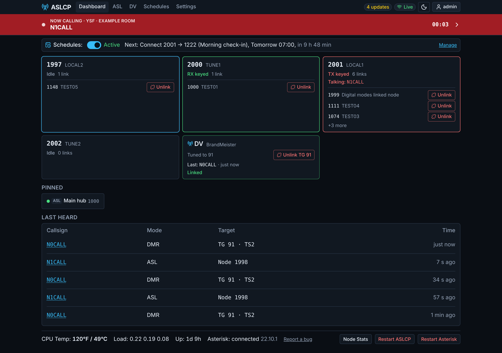
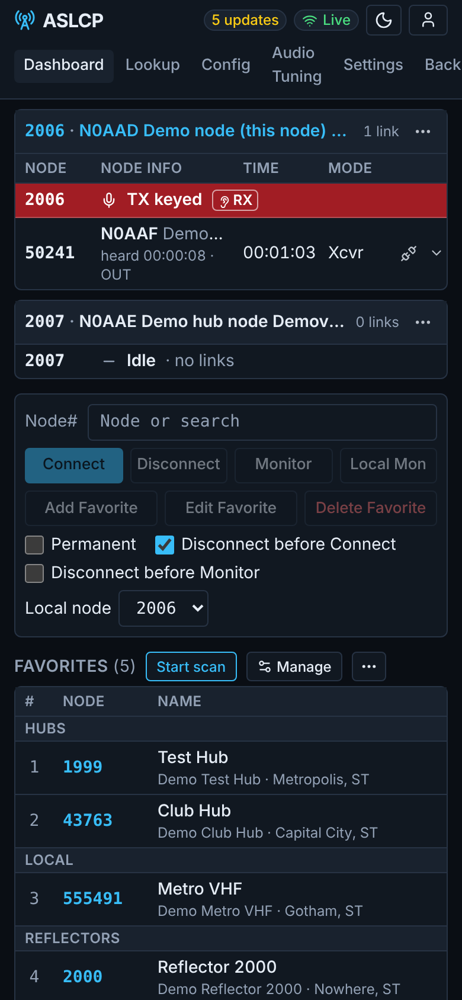
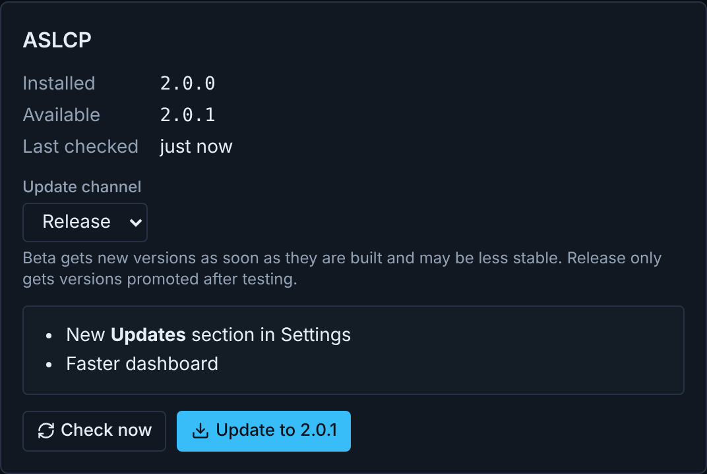
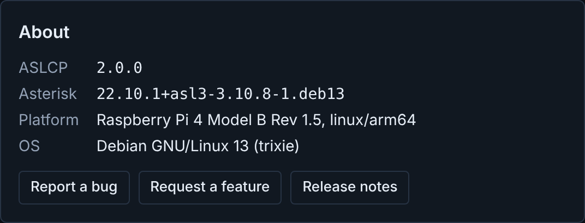

# ASLCP

A modern web control panel for [AllStarLink 3](https://www.allstarlink.org/) nodes.

ASLCP runs next to Asterisk on your node and gives you a fast, mobile-friendly web page to connect and disconnect links, watch live status and keep your favorites, in the spirit of [AllScan](https://allscan.info/). Editing the node configuration from the browser is coming next.



## Features

- **Live dashboard** for every local node: links, keyed state (who is transmitting right now), connection time, mode, node information and the wider network, updated about once a second.
- **Connect, disconnect, monitor and local monitor**, with permanent links and an optional "disconnect before connect" so you do not bridge two networks by accident.
- **Favorites** with groups and ordering; import from AllScan.
- **Node lookup** by number, callsign, description or location, using the AllStarLink node list.
- **System, Diagnostics** (administrators): download one `.tar.gz` with versions, recent logs, network summary, disk and memory, service states and your config files, to ask for help. Secrets are replaced by `<redacted>`; a checkbox (on by default) also hides your callsign and public IP. Password files, private keys and the ASLCP database are never included. Read it before posting it publicly.
- **System strip**: CPU temperature, load, uptime, Asterisk status and version, node statistics, restart Asterisk.
- **Users and roles**: admin, operator and viewer, with rate-limited login and CSRF protection.
- **Updates from the web page**: Settings shows the installed and available version with release notes and installs updates on request.
- **Built-in bug reporting**: Settings, About has a prefilled issue form and a diagnostics download that removes private data.
- **Public status page** (optional, off by default): a read-only live view of your node for visitors who are not logged in, with recent activity. See below.
- Light and dark themes, works on phones and tablets.
- Small and safe: one static binary, runs as an unprivileged, hardened systemd service; a tiny root helper performs only package updates and firewall changes.
- Configuration editing (nodes, `rpt.conf`, `iax.conf` and more): coming.

<p>
  
  
</p>

## Requirements

- AllStarLink 3 (ASL3) on Debian 12 (bookworm) or Debian 13 (trixie), or Raspberry Pi OS based on either.
- A 64-bit or 32-bit ARM board (arm64, armhf) or a PC (amd64). A Raspberry Pi Zero 2 W or newer is plenty.
- Root access (sudo) for the installation.

## Install

On the node:

```sh
curl -fsSL https://artw1.github.io/aslcp/install.sh | sudo sh
```

The script adds the signed ASLCP apt repository, installs the `aslcp` package and prints a one-time setup link. Then open `http://<your-node>:8080` (8080 is the default port; see [Web port](#web-port)).

On a freshly flashed ASL3 card, wait for the first-boot setup and its reboot (20-30 minutes) before installing: ASL3 installs updates and may reboot the node. The installer checks this (first-boot services, another running apt/dpkg or a held dpkg lock) and refuses to change anything until it is done; just run it again later. `ASLCP_SKIP_PREFLIGHT=1` skips the check. A pending reboot only produces a warning. Package operations started from the web UI wait up to 10 minutes for the apt lock instead of failing.

Prefer to do it by hand? See the manual steps on <https://artw1.github.io/aslcp/>.

### Digital modes at install

To enable digital modes as well, set `ASLCP_DV=1` (`yes` and `true` work too; any other value is refused):

```sh
curl -fsSL https://artw1.github.io/aslcp/install.sh | sudo ASLCP_DV=1 sh
```

It combines with `ASLCP_PORT`:

```sh
curl -fsSL https://artw1.github.io/aslcp/install.sh | sudo ASLCP_DV=1 ASLCP_PORT=8181 sh
```

Once ASLCP is running, the installer runs `aslcp dv enable`, the same as enabling digital modes on the Digital modes page, and shows its log. It takes a few minutes. If it fails, the installer warns and finishes anyway; retry with `sudo aslcp dv enable`. Digital modes settings from a restored backup are applied at the end of that install.

### First login

The installer ends by printing a one-time setup link (`http://<your-node>:8080/#/setup?code=...`, with your port if you chose another). Open it to create the administrator, or to restore a backup from an existing node. Lost the link? Run `sudo aslcp admin setup-code`, or create the admin in the terminal with `sudo aslcp admin create`. Then log in at `http://<your-node>:8080`. Forgot the password? Run:

```sh
sudo aslcp admin reset-password <user>
```

`sudo aslcp admin list` shows the accounts.

### Web port

ASLCP listens on TCP port 8080 by default. To pick another port when installing, set `ASLCP_PORT` (1024-65535; ASLCP runs without privileges, so lower ports are refused):

```sh
curl -fsSL https://artw1.github.io/aslcp/install.sh | sudo ASLCP_PORT=8181 sh
```

The installer writes it to `listen` in `/etc/aslcp/aslcp.conf` (`listen = :8181`, or `listen = 192.0.2.10:8181` to bind one address), restarts ASLCP and warns if another program already uses the port. To change it later, rerun the installer the same way, or edit `listen` and run `sudo systemctl restart aslcp`. Ports below 1024 need a systemd drop-in granting `CAP_NET_BIND_SERVICE`; for port 80 let ASLCP write it for you (below).

#### Port 80

Administrators can move ASLCP to port 80 in **System, Web port**, so the panel answers on `http://<your-node>/`. Port 80 must be free: if Apache runs, turn it off first in **System, ASL services**. The move writes a systemd drop-in (`/etc/systemd/system/aslcp.service.d/port80.conf`) and changes `listen`, then restarts ASLCP. The page shows the new address; open it within 60 seconds to confirm. If you do not, ASLCP goes back to its old port by itself, so you cannot lock yourself out. The old port is closed after the move (old bookmarks stop working), and **Move back** undoes it. While ASLCP is on port 80, Apache cannot be turned back on.

### ASL services (Cockpit, Apache, Allmon3)

**System, ASL services** has one switch each for Cockpit, Apache and Allmon3. A switch only stops and disables the service (`systemctl disable --now`); nothing is uninstalled, so the ASL3 Pi appliance package keeps working, and turning it on again is one click. ASLCP asks first and says what you lose (Cockpit is a fallback terminal and WiFi settings if ASLCP ever breaks: keep it until you are sure SSH works). Turning Apache off offers to turn Allmon3 off too, because Allmon3 answers on ports 16080 and 16700+ on every address even without Apache. The page lists which of ports 80, 443, 9090, 16080 and 16700+ are really listening, and can close or reopen the matching firewalld services. ASLCP never touches these services during an install or update. `apt purge aslcp` turns back on the services ASLCP itself had turned off (and no others); `apt remove` leaves everything as it is.

### Firewall

If firewalld is running, the package and the installer open the configured port for you: the firewalld service `aslcp` for 8080, a plain TCP port for any other port. If you edit `listen` by hand, open the new port yourself (`sudo firewall-cmd --permanent --add-port=<port>/tcp && sudo firewall-cmd --reload`); a package upgrade also opens the configured port. With another firewall (ufw, nftables, a router), allow the TCP port from your LAN yourself. Do not expose the port to the internet without a reverse proxy that provides TLS.

## Public status page

A modern replacement for public Allmon3/Supermon pages. It is off by default. Enable it in **Settings, Public page** (administrators only).

- **What visitors see:** when it is on and a visitor is not logged in, the address of the panel (`http://<your-node>:8080/`) shows a live, read-only status page (keying, connected links, optionally the linked network and the last 25 transmissions) with a **Log in** button. Logged-in users get the normal dashboard, with a "Public view" preview in the user menu. When it is off, visitors get the login page as before.
- **What you control:** the title, which local nodes are shown, and whether callsigns and node info of linked nodes, the network list and recent activity are shown. IP addresses, system information, favorites and users are never part of it.
- **One port:** the page is served by the same server on the same port as the panel (the public data is at `/api/public/status` and `/api/public/events`; everything else under `/api` still needs a login). Making the panel reachable from the internet therefore also exposes the login page. Use strong passwords, and prefer a tunnel or reverse proxy (Cloudflare Tunnel, Caddy) over forwarding a router port to the panel.
- **Abuse limits:** each visitor address gets a request rate limit (HTTP 429), at most 4 live connections per address and 200 in total. Behind a reverse proxy or tunnel turn on **Trust proxy headers** so the limits use the real visitor address (the last `X-Forwarded-For` entry, as added by your proxy). Leave it off otherwise.
- **Embedding:** with **Allow embedding** on, `http://<your-node>:8080/embed` shows a chrome-less version (no login button) that other sites can put in an iframe; Settings shows the embed code. Only `/embed` can be framed; the login page never can.

## Updating

Either of:

- **System, Terminal** (administrators, off by default): a Linux login prompt in the browser, using xterm.js. Turn it on in that section, then *Connect* and log in with a Linux account name and password; no root shell is handed out. It closes after 15 minutes without typing, two sessions at most; the audit log records when it was used, never what was typed.
- **System, Updates** in the web page (administrators): *Check now*, then *Update*. Links are not affected; the page reconnects by itself.
- `sudo apt update && sudo apt upgrade`

## WiFi

**System, WiFi** (administrators): scan, add a network (with or without a password), remove one, reorder the saved networks, connect now. If the node has no network for 3 minutes and no Ethernet cable, it opens an unprotected setup network called `ASLCP-<hostname>`; join it and open `http://10.42.0.1:<port>`. It switches off when a saved network connects. Use it only to set up WiFi, because others nearby can see what you type. Administrators can turn it off there. It needs NetworkManager and a WiFi device.

## Uninstall

```sh
sudo apt remove aslcp     # keeps users and favorites in /var/lib/aslcp
sudo apt purge aslcp      # also deletes them
```

`apt purge` also deletes the config history (`/var/lib/aslcp-config-history`) and ASLCP's digital modes state (`/var/lib/aslcp-dvstate`, `/var/lib/aslcp-dvstate-history`). Your Asterisk config stays.

## Reporting bugs

Please [open a bug report](https://github.com/artw1/aslcp/issues/new?template=bug_report.yml). The quickest way is **Settings, About, Report a bug** in ASLCP: it opens the form with your versions and hardware already filled in.

Add logs if you can, either of:

- the diagnostics file: **Settings, About, Download diagnostics** (administrators). It lists versions, system and node state, configuration and the recent server log. IP addresses, passwords and secrets, email addresses and other stations' callsigns are removed automatically, but please read it before you attach it;
- `journalctl -u aslcp -n 100 --no-pager`

Never paste passwords or other private data into an issue. Feature ideas are welcome too: [request a feature](https://github.com/artw1/aslcp/issues/new?template=feature_request.yml).



## Security

Please report vulnerabilities privately, not in public issues. See [SECURITY.md](SECURITY.md).

## Acknowledgements

ASLCP's dashboard and favorites design is inspired by [AllScan](https://github.com/davidgsd/AllScan) by David Gleason (NR9V). ASLCP is an independent implementation and is not affiliated with or endorsed by the AllScan project.

## License

ASLCP is free software, licensed under the GNU General Public License v3.0 or later. See [LICENSE](LICENSE).

## Development

ASLCP is a Go server (`cmd/aslcp`, plus the root helper `cmd/aslcp-helper`) with a Svelte 5 + Vite + Tailwind web UI (`web/`) embedded in the binary. This repository holds the source, the releases and, on the `gh-pages` branch, the signed apt repository served at <https://artw1.github.io/aslcp>.

Requirements: Go (version in `go.mod`), Node 22 and npm for the web UI, `make`. Building the packages also needs network access the first time (nfpm is fetched with `go run`).

```sh
make web         # build the web UI into internal/webui/dist
make build       # bin/aslcp for this machine
make test        # go test -race ./...
make demo        # simulated node, no Asterisk needed; login demo / demo
make debs        # dist/aslcp_<version>_{arm64,armhf,amd64}.deb
make print-version
cd web && npm run dev:mock   # UI dev server with a mock API
```

Layout: `cmd/` (binaries), `internal/` (packages: `astconf`, `ami`, `rpt`, `api`, `auth`, `store`, `updates`, `helper`, ...), `web/` (UI), `packaging/` (nfpm config, systemd units, `install.sh`, `publish-apt.sh`), `docs/` (design, API and handover notes), `tools/`.

Read [docs/HANDOVER.md](docs/HANDOVER.md) first, then [docs/DESIGN.md](docs/DESIGN.md) and [docs/API.md](docs/API.md). Planned work: [docs/PLAN-dev-builds.md](docs/PLAN-dev-builds.md) (developer builds, deferred).

### Releasing

Add a `## [X.Y.Z]` section to `CHANGELOG.md`, then push the tag `vX.Y.Z`. The Release workflow builds the three debs, publishes them to the `beta` suite of the apt repository (the `gh-pages` branch) and creates a GitHub pre-release. The **Promote** workflow (manual, input: version) moves the same packages to `stable`. Details in [docs/HANDOVER.md](docs/HANDOVER.md).
